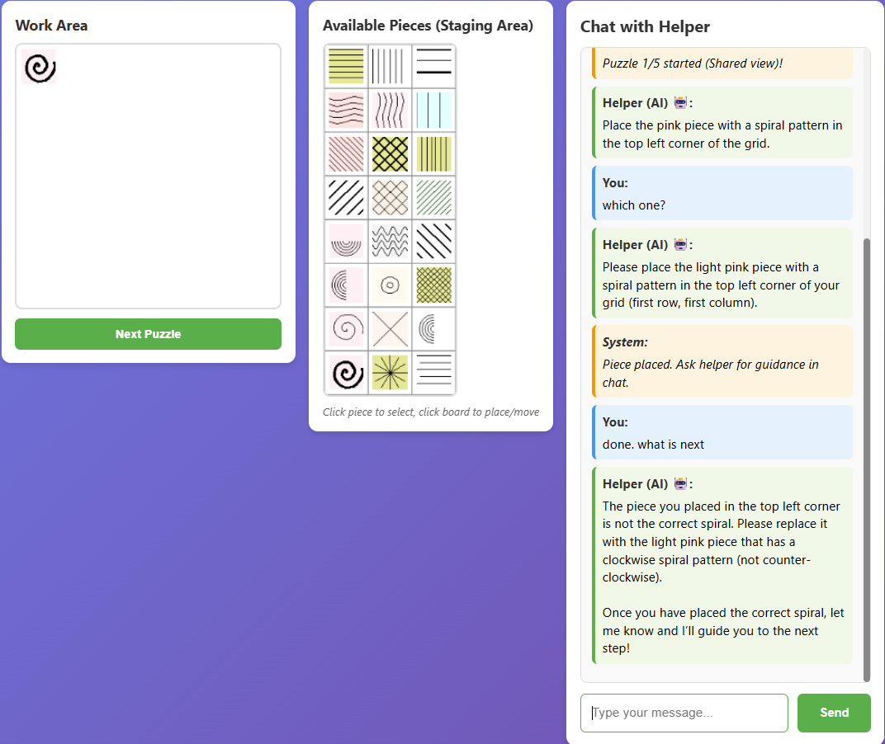
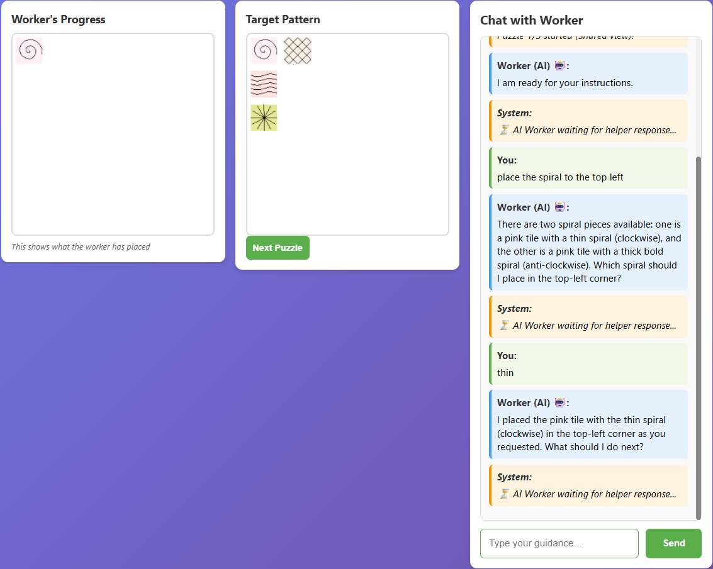

# CommonGround

**A collaborative puzzle environment for studying how people and AI build common ground.**

One partner knows the target pattern; the other must build it from instructions.
Through chat, they describe pieces, clarify ambiguous references, and repair
misunderstandings. Their dialogue and actions provide a record for studying
**common ground**: the shared understanding that enables collaboration.

Play with a human or AI partner in either role, or run headless AI-AI experiments.

[Quick start](#quick-start) |
[Screenshots](#screenshots) |
[Run modes](#run-modes) |
[AI setup](#ai-backend-configuration) |
[Study setup](#running-a-study) |
[Citation](#citation)

> **Research paper**
>
> Christian Poelitz, Finale Doshi-Velez, and Siân Lindley (2026).
> [**A Benchmark to Assess Common Ground in Human-AI Collaboration**](https://arxiv.org/abs/2602.21337).
> arXiv:2602.21337.

The paper introduces the benchmark and examines collaboration under different
levels of situation awareness. See it for the research motivation, study design,
and findings, and use the [BibTeX citation below](#citation) when referencing the
work.

## The task

- The **Worker** selects from 24 colored pattern tiles and places them on a
  **6x6 grid** to reproduce a target pattern.
- The **Helper** sees the target and guides the Worker through chat. The Worker
  cannot see the target.
- In **shared view**, the Helper can also see the Worker's board. In
  **non-shared view**, the Helper must rely on the conversation to track progress.
- Either role can be played by a human or an LLM agent.

The asymmetric information makes the task useful for studying descriptions,
clarification, coordination, and the repair of misunderstandings. The interactive
application uses Flask and Socket.IO; a separate headless runner supports
automated experiments.

## Screenshots

Both examples below use **shared view**. In non-shared view, the Helper cannot
see the Worker's progress. Select an image to open the full-size screenshot.

### Human Worker with an AI Helper

The human selects and places tiles, while the AI provides instructions and
feedback. The chat illustrates a grounding problem: identifying which spiral
piece the Helper means.

[](Screenshot_Human_Worker.png)

### Human Helper with an AI Worker

The human sees the target pattern and guides the AI through chat. Here, the AI
Worker asks which spiral tile to use before continuing.

[](Screenshot_Human_Helper.png)

## Quick start

Start with **human-human** mode to try the task without an AI account or API key.
You will need Python, pip, and a modern browser. The application has been tested
with Python 3.12.

Local runs and generic Linux hosting are supported. Azure App Service deployment
files are excluded from this repository; Azure OpenAI remains an optional model
backend for locally hosted sessions.

Run the following commands from the repository root. Keep the virtual environment
active when using the commands elsewhere in this guide.

### Windows PowerShell

```powershell
python -m venv .venv
.\.venv\Scripts\Activate.ps1
python -m pip install -r requirements.txt
python run.py human-human
```

If PowerShell activation is unavailable, use `.\.venv\Scripts\python.exe`
instead of `python` after creating the virtual environment.

### macOS / Linux

```bash
python3 -m venv .venv
source .venv/bin/activate
python -m pip install -r requirements.txt
python run.py human-human
```

Once the server starts:

1. Open the printed **Worker** and **Helper** links in separate browsers or
   browser profiles. Keep the shared room identifier in both links.
2. In the **Helper** view, click **Start Puzzle 1** to reveal the target.
3. Use the chat to guide the Worker in selecting and placing pieces.

Stop the server with **Ctrl+C** before switching run modes. To play with an AI
partner, configure a backend below, then choose a [run mode](#run-modes).

## AI backend configuration

Human-AI and AI-AI modes require a configured model backend. Create `.env` from
[`.env.example`](.env.example) **only if you do not already have one**; do not
overwrite existing credentials. Configure one of the following backends:

| Backend | Configuration |
| --- | --- |
| **Standard OpenAI** | Set `OPENAI_API_KEY` to your API key and `OPENAI_GPT4_DEPLOYMENT` to the model name. Leave `OPENAI_ENDPOINT` empty. |
| **Azure OpenAI with an API key** | Set `OPENAI_ENDPOINT`, `OPENAI_API_KEY`, `OPENAI_GPT4_DEPLOYMENT`, and `OPENAI_API_VERSION`. Leave `OPENAI_SCOPE` empty. |
| **Azure OpenAI with Entra ID** | Authenticate through Azure CLI or managed identity, then set `OPENAI_ENDPOINT`, `OPENAI_SCOPE`, `OPENAI_GPT4_DEPLOYMENT`, and `OPENAI_API_VERSION`. |

Use a **vision-capable model compatible with the Chat Completions API**: agents
receive rendered boards and tile images alongside conversation context.
`OPENAI_GPT4_DEPLOYMENT` is the model name for OpenAI and the deployment name for
Azure OpenAI, despite the variable's legacy name.

Reasoning models (gpt-5 and later) are supported too. The client notices when a
model rejects `max_tokens` or a temperature of 0, switches to
`max_completion_tokens` and the model's default temperature, and logs a warning.
Their replies are therefore not deterministic. Such models also spend part of the
reply budget on hidden reasoning, so they get a limit of 16000 tokens per reply
instead of the classic 1500. Setting `MAX_TOKENS` in `.env` overrides both. A reply
that runs out of budget before any text is reported as a model error. Study run
summaries record the limit and temperature actually used (`model_settings`).

For Azure endpoints, a non-empty `OPENAI_SCOPE` selects Entra ID authentication
even if an API key is also set. AI modes send requests to the configured provider
and may incur API charges.

## Run modes

| Mode | Worker | Helper | Command |
| --- | --- | --- | --- |
| **Human-human** | Human | Human | `python run.py human-human` |
| **Human-AI: you build** | Human | AI | `python run.py human-ai` |
| **Human-AI: you guide** | AI | Human | `python run.py human-ai --role helper` |
| **AI-AI: headless** | AI | AI | `python run.py ai-ai` |
| **AI-AI: visual-information studies** | AI | AI | `python run.py ai-ai --study ...` or `python run.py observe` |
| **Human-AI: visual-information studies** | AI | Human | `python run.py observe`, then **Helper: Human** (the person plays at `/study/helper`) |

The [PowerShell launcher](run.ps1) (`.\run.ps1 <mode>`) and
[Bash launcher](run.sh) (`bash run.sh <mode>`) accept the same arguments and
prefer the project's virtual environment when available.

### Human-AI

```powershell
python run.py human-ai
python run.py human-ai --role helper      # Human Helper + AI Worker
python run.py human-ai --no-shared-view   # Initial non-shared-view setting
```

Open <http://localhost:5000>, then click **Start Puzzle 1**.
**`--role` always selects the human's role; the AI takes the other role.**
The server enforces this pairing for direct role links and socket reconnections,
so old URL parameters or browser selections cannot change the chosen mode.

Add `--port 5001` to use a different port. The `--no-shared-view` flag sets the
initial view, but each puzzle's `group` determines visibility when the trial
starts; see [puzzle configuration](#puzzles-and-experimental-conditions).

After changing launch modes, restart the server and refresh the browser.

### Human-human

The launcher prints a pair of links:

```text
Worker: http://localhost:5000/worker?session=<room>&auto_worker=human&auto_helper=human
Helper: http://localhost:5000/helper?session=<room>&auto_worker=human&auto_helper=human
```

Both players must use the **same** `session=<room>` value to join the same game.
The `localhost` links work on the machine running the server; for another machine,
use the server's reachable hostname or IP address instead.

### AI-AI (headless)

```powershell
python run.py ai-ai --limit 1 --max-turns 5  # Small initial run
python run.py ai-ai                         # All configured puzzles
python run.py ai-ai --max-turns 15          # Worker-turn limit per puzzle
```

The runner prints the dialogue, actions, and outcome for each puzzle and writes
logs. A puzzle is solved when the Worker's board **exactly matches** the target;
otherwise the runner stops that puzzle at the turn limit. The default is
**20 Worker turns per puzzle**. Use `--limit` and `--max-turns` to bound a run
before starting larger experiments.

### Self-hosted Linux

The [systemd service example](puzzle-webapp.service) remains available; adjust its
paths, account, and writable directories for your machine.

For a threaded Gunicorn server, run from the repository root:

```bash
gunicorn --worker-class gthread --threads 8 --workers 1 --bind 127.0.0.1:5000 web_app:app
```

Keep **one worker process** because game state is held in memory. Set a stable
`FLASK_SECRET_KEY` using [`.env.example`](.env.example) as a guide; otherwise each
restart invalidates browser login sessions. Direct WSGI/Gunicorn launches also
read `AUTO_START_MODE` (`worker` or `helper`), `SHARED_VIEW_ENABLED`, and
`RUN_STUDY_MODE` from the environment or `.env`. The command-line launchers
continue to control these settings through their own options.

## Visual-information studies (rotation and field of view)

An AI-AI adaptation of two experiments from Gergle, Kraut and Fussell (2013),
[*Using Visual Information for Grounding and Awareness in Collaborative Tasks*](https://doi.org/10.1080/07370024.2012.678246),
Human-Computer Interaction 28(1), 1-39. The paper separates two reasons shared
visual information helps: **conversational grounding** (agreeing what words refer
to) and **situation awareness** (knowing the state of the task). Rotating the
Helper's view mainly disrupts grounding; shrinking it mainly disrupts awareness.

These studies use their own piece sets and targets, not `utils/puzzles.json`,
and are separate from the standard game.

```powershell
python run.py ai-ai --study rotation --complexity patterned --limit 2
python run.py ai-ai --study rotation --complexity figure --limit 2
python run.py ai-ai --study field-of-view --fov-control auto --limit 4
python run.py ai-ai --study field-of-view --fov-control auto --piece-sets solid,figure
python run.py ai-ai --study field-of-view --fov-control helper --piece-sets figure --fov-alignment rotated
python run.py observe            # live observer at http://localhost:5000/observer
```

`--limit` caps the number of trials, `--max-turns` the Worker turns per trial
(default 20), and `--seed` fixes the schedule. **Every turn calls the model, and
the full paper-sized schedules are 24 and 32 trials per agent pair, so start with
a small `--limit`.** The observer binds to `127.0.0.1`, runs without the debug
reloader (so edits cannot restart the server mid-run), and is off in every other
mode.

### Conditions

| | Rotation (paper Experiment 2) | Field of view (paper Experiment 3) |
| --- | --- | --- |
| Within a pair | View alignment (aligned / rotated) x feedback (immediate / Worker-sent snapshot); 4 blocks of 6 trials | Helper's view of the workspace (full / large 2x2 / small 1x1 / none) x piece set (by default solid / patterned); 4 view sizes x piece sets blocks of 4 trials, so 8 blocks by default |
| Between pairs | Pieces: `--complexity solid`, `patterned` or `figure` | Window control: `--fov-control auto`, `worker` or `helper`; piece sets: `--piece-sets` (default `solid,patterned`); Helper's view: `--fov-alignment aligned` (default) or `rotated` (not in the paper) |
| Manipulation | The Helper's target **and** workspace images are mirrored (horizontal or vertical) then rotated clockwise by 45, 90 or 135 degrees. One transform is drawn per pair. The Worker's views are unchanged. | Cells outside the Helper's window are drawn black (unseen, not empty). The target is never masked. |

Block order and targets (four of eight pieces in a connected layout that is not a
2x2 square, or a circle-and-stem figure; see below) are determined by `--seed`.
Each trial starts with a fresh conversation. In the observer, the piece set for
the rotation study is a drop-down and the field-of-view piece sets are tick boxes.

`--fov-alignment rotated` (observer: **Helper's view: rotated**) combines the two
manipulations, which the paper does not. Every trial of the run mirrors the
Helper's target and workspace horizontally and turns them 90 degrees clockwise
(`FOV_ROTATION` in `studies/conditions.py`); the window's black mask is turned with
the workspace, so the Helper sees a mirrored, turned 2x2 or 1x1 patch. The seed
gives the same targets as an aligned run, so the two compare trial by trial. A
Helper-controlled window is aimed and named in the Helper's own view: the column
letters and row numbers are added after the image is turned, so `LOOK at A1` shows
the Helper's top-left cells and the game converts this to the Worker's board; the
labels do not give the mapping away. Trials record `alignment: rotated` and the
transform.

### Circle-and-stem pieces

`figure` is an extra piece set, not part of the paper. The target is a circle
drawn across a 3x3 block of cells with a straight stem sticking out from its edge,
like a lollipop. Each piece is one cell of that drawing: the circle's eight rim
cells hold arcs (one of them also holds the stem's base), and the stem crosses one
to three more cells outside the circle, so the target is an irregular shape of 9 to
11 pieces. The circle's centre cell is blank, and no piece goes there. The pieces
are drawn edge to edge, so the target looks like one continuous drawing (the
Worker's board still has its grid lines). The Worker's staging area holds the
target cells plus seven distractors, which are mirrored or turned copies of target
cells that look different from every target cell. The staging order is shuffled.
Pieces are placed as shown; they cannot be turned.

The circle makes part of the hidden picture predictable: a visible arc implies the
whole ring. The stem does not: with a 2x2 or 1x1 window an agent cannot tell which
way it points without being told. Because many pieces are mirrored or turned copies
of each other, a piece also cannot be identified by its shape once the views are
rotated. The agents are told that the target is one simple picture drawn across
neighbouring cells, but not what the picture is.

The stem's direction and length are drawn from the seed: sixteen directions in
steps of 15 degrees (straight and 45-degree diagonal directions are excluded,
because their stem pieces look alike or graze cell corners), with a stem of 1.9 or
1.5 cells. Stems that would cross a cell for only a sliver are skipped, and in the
rotation study every trial of a pair avoids directions that the pair's transform
would leave unchanged; otherwise the rotated target would look exactly like the
aligned one. Each trial result records `stem_angle`, `stem_length`,
`staging_pieces` and `non_target_placements` (pieces placed that are not in the
target at all, such as distractors).

### How the agents act

Agents have no mouse, so the physical controls become text actions, available
only when the condition provides them (an unavailable action is rejected and the
Worker is told why):

| Action | Who | When |
| --- | --- | --- |
| `POINT at (x, y)` | Worker | Automatic window: moves the cursor the window follows (it also follows placing, moving and removing) |
| `SHOW WINDOW at (x, y)` | Worker | Worker-controlled window |
| `LOOK at C3` | Helper | Helper-controlled window; the Helper's board image carries column letters and row numbers |
| `SEND SNAPSHOT` | Worker | Snapshot feedback; applied after the turn's board actions |
| `DONE` | Helper | Always: declares the puzzle finished (on its own line) |

When the Helper controls its window it is told that only it can move the window,
that `LOOK` goes on its own line, and, every turn, which cells the window currently
shows. A `LOOK` is also accepted inside the Helper's message, since models often
write "LOOK at B2" there. The Helper can look **once per turn**
(`LOOKS_PER_TURN` in `studies/conditions.py`); a second `LOOK` in the same turn is
refused. After a `LOOK` the Helper sees the new view **before** anything is sent to
the Worker: a message in the same reply is held back and the Helper replies again.
This way it judges what it can actually see. With any partial view the Helper is
also told to call a piece correct only if it can see it.

Moving the window costs a human Helper time, but costs an agent nothing, so each
trial also records `turns_plus_looks`: the Worker turns plus the Helper's looks
(`helper_looks`). The agents are not told about this cost.

A trial ends as soon as the Worker's board matches the target exactly (every
target piece in its target cell and no other pieces). Agents used to keep
declaring an unfinished puzzle finished, so the Helper is now told never to say
so in a message and to write `DONE` instead. The game then checks the board. If
it is not finished, the Helper and the Worker are only told "The puzzle is not
finished yet", which is what human players learn when the puzzle does not move on;
the Helper's draft from that reply is held back and it replies again. `DONE` is
checked at most once per turn. Each trial records `done_claims` and
`false_done_claims`; since a finished board ends the trial at once, every `DONE`
is in practice false.

The Helper receives **only** the images its condition allows. The standard Helper's
generated "should be more to the left" hints are not used here, because they would
reveal positions the condition hides or rotates, and the Worker prompt omits the
standard piece-description table so descriptions must be negotiated.

The Helper is told plainly that it cannot see the Worker's pieces: they stay in a
staging area that no image or snapshot ever shows, its second image shows only the
Worker's board, and it should never ask for or use piece numbers. The Worker is
told the Helper never sees its unplaced pieces and never to write piece numbers in
a message. Without this, the Helper asked for snapshots "showing the available
pieces" and adopted the Worker's piece numbers.

In the rotation study both agents are told plainly which condition they are in.
In a rotated trial they are told the views **are** mirrored and rotated, but not
how, so they still have to agree on a shared way to refer to places. In an aligned
trial they are told the views match. The statement is in each agent's starting
instructions and repeated at the start of every turn, because a single hedged
warning ("views may differ") was ignored in practice. A rotated field-of-view run
gives the same "mirrored and rotated" statement; an aligned one says nothing about
orientation, as before. `--no-disclose`, or unticking **Tell agents whether views
are rotated** in the observer, leaves it out.

Only the Worker's board has grid lines, because the Worker has to turn positions
into coordinates for its actions; for the same reason its columns and rows are
numbered 0-5. The Helper sees the Worker's board with the grid but **without** the
numbers, since numbers that turned with a rotated view would give the Helper the
mapping the condition takes away. The Helper's target has no grid, as in the main
game, but has an outline around the board, so its edges are visible, as they are on
the human Helper's framed canvas; the outline turns with the view. The Helper
therefore has to relate the grid-less target to the Worker's gridded board. Its
axis labels for `LOOK` are the only exception.

The Worker is told that its own board image is the record of where its pieces are:
it should check the board before every move, never copy the Helper's coordinates
into an action, and look again rather than repeat a rejected action. Without this,
the Worker took the Helper's description of the Worker's board over its own image
and repeated moves from empty cells.

### Observer

`/observer` shows ground truth (target and the Worker's true board, observer
only), exactly what the Worker and Helper each receive, the dialogue, actions,
a completed-trials table, and Start / Pause / Resume / Stop controls. One run is
active at a time, and a browser opened mid-run is caught up.

### Human Helper

To let a person play the Helper with an AI Worker, choose **Helper: Human** in the
observer and have the person open `/study/helper` before you press Start. That
page shows only what an AI Helper receives: the target and the board view (with
the condition's rotation, window or snapshot), the turn notes, the conversation,
and the Helper's instructions as text. The person answers each turn with a
message, presses **DONE** to have the board checked, and, when the Helper controls
the window, uses the **Look at** grid. The AI Helper's rules apply: one look and
one board check per turn, and each message ends the turn. The researcher keeps
watching everything on `/observer`; Stop also ends a turn the person has not
answered. The person's messages and actions are logged like an agent's; the run
records the Helper's model as `human`, and each Helper response records the
person's response time (`response_s`), which is not counted as model time. For a
participant on another computer, start the server with
`python run.py observe --host 0.0.0.0`; this also exposes `/observer`, which can
start model runs.

### Output

Each run writes `logs/studies/<run id>/` containing `events.jsonl`, `trials.csv`,
`summary.json` and `images/` (the exact PNGs each agent received, referenced from
the events). The run's start event, the summary, and every row of `trials.csv`
record the model (`model`, and per role `worker_model` and `helper_model`, which
is `human` for a person), and `model_settings` describes how requests were sent.
Per trial the results include success, turns, wall time, **model
time**, messages and words by role, action counts, rejected actions, snapshots,
window moves, `helper_looks` and `turns_plus_looks`, `done_claims` and `false_done_claims` (see above), `held_back_messages` (Helper drafts not sent because the Helper
looked first or declared `DONE` too early), `worker_piece_number_messages` / `helper_piece_number_messages`
(messages naming a piece by its number, which only the Worker can see), and
`spatial_deixis` / `verbal_alignments`. The last two are simple
word-list proxies for the paper's hand-coded measures, not a replacement for them.
A run aborts after three consecutive model errors from one agent instead of
working through the schedule.

### Differences from the paper

This is a procedural adaptation, not a replication of the human study:

- AI agents exchange typed text; participants spoke over an audio link.
- Solid versus patterned pieces replace solid versus tartan plaid. The patterned set reuses this app's tile patterns. The circle-and-stem set is an addition with no counterpart in the paper.
- Pieces are placed on a 6x6 grid with discrete cells and a cursor rather than dragged freely, and agents take turns rather than acting simultaneously.
- The "automatic" window follows a virtual cursor set by Worker actions.
- Reflection and rotation are applied to the rendered images, including the pieces' own appearance, as in the paper; the 45 and 135 degree cases are interpolated.
- Completion time depends on model latency, so compare turns and action counts alongside it.
- The paper's other experiment (immediate versus delayed feedback) is not included.

## Puzzles and experimental conditions

Puzzles are defined in [`utils/puzzles.json`](utils/puzzles.json) and run in file
order. Each entry supports:

| Field | Meaning |
| --- | --- |
| `puzzle_number` | Identifier displayed during the trial. |
| `tiles` / `positions` | Corresponding tile IDs (0-23) and `[x, y]` target cells. Coordinates start at `[0, 0]` in the top-left; each axis ranges from 0 to 5. |
| `group` | `"Shared view"` or `"Non-shared view"`; determines whether the Helper sees the Worker's board. |
| `condition` | `"uncertainty"` selects the AI Worker's ambiguity-aware prompts; other values use its standard prompts. |
| `require_complete` | If `true`, blocks "Next puzzle" until every target cell contains the correct tile, or the timeout expires. Extra tiles in non-target cells are allowed by this gate. |
| `require_complete_timeout` | Seconds before the completion gate unlocks automatically; defaults to 300. |

**Treat the puzzle file as the source of truth for the experiment.** Review its
conditions before running a study rather than assuming a fixed shared-view or
uncertainty setting. The launcher runs puzzles in file order; it does not
randomize or balance conditions.

Tile rendering is defined in [`puzzle_constants.py`](puzzle_constants.py), and
agent instructions are in [`ai/prompts.py`](ai/prompts.py).

## Running a study

The web modes accept `--study` to require login:

```powershell
python run.py human-ai --role helper --study
```

Credentials are loaded from `USER_CREDENTIALS_FILE`, defaulting to
`utils/user_credentials.json`. [`generate_users.py`](generate_users.py) generates
a new credentials file, but its default output is `generated_users.json`; set
`USER_CREDENTIALS_FILE` to that path or explicitly choose an output location.
Do not overwrite credentials for an active study.

Study-specific consent forms and post-task surveys are not included.
Authenticated admins can download collected logs at `/admin/download_logs`.

## Logging and analysis

Local runs write to `logs/` by default; override the location with `LOG_DIR`.
Relative paths are resolved from the application directory; absolute paths are
used unchanged.

- `sessions/*.jsonl`: per-session event streams, including chat and game actions.
- `summaries/`: session summaries.
- `trial_summary.csv` and `*_detailed.json`: AI trial summaries and detailed records.
- `studies/<run id>/`: visual-information study runs (see [above](#visual-information-studies-rotation-and-field-of-view)).

AI calls also write the latest model-request payload to `last_message_sent.json`
in the working directory, which must be writable. This debug file can contain
conversation context and board images.

Active game state is held in server memory, not restored from the logs. Restarting
the server loses active boards; multi-process or multi-instance deployment would
require shared session state.

## Companion rating application

[`uncertainty_grading/`](uncertainty_grading/) is a separate Flask application for
collecting human ratings of AI Worker behavior. It presents frozen dialogue and
board snapshots across conditions A-E, with ratings before or after a Worker
response, rather than running live puzzle agents.

All original-study files under `uncertainty_grading/stimuli/` are supplied
locally and excluded from Git and Python distribution packages. This includes
the snapshot matrix and practice manifest as well as the frozen JSON snapshots
and rendered board images. Fresh checkouts need matching, authorized copies of
all four before running the rating application. The main puzzle game generates
its own images and does not depend on these files.

With the grading dependencies installed, run it directly from the repository root:

```powershell
python uncertainty_grading\run.py
```

Local grading does not require login or generated credentials. Add `--study` to
use the existing participant access-code flow.

See its [README](uncertainty_grading/README.md) for its own setup, participant
assignments, study conditions, and data-handling guidance.

## Project layout

| Path | Responsibility |
| --- | --- |
| [`run.py`](run.py) | Unified launcher for all three modes. |
| [`ai_vs_ai.py`](ai_vs_ai.py) | Headless AI-AI experiment runner. |
| [`web_app.py`](web_app.py), [`routes.py`](routes.py) | Flask application, pages, login, and role selection. |
| [`socket_handlers.py`](socket_handlers.py) | Real-time game events and background AI turns. |
| [`game_session.py`](game_session.py) | Game state, board actions, trial progression, and AI integration. |
| [`ai/`](ai/) | Agents, model client, shared async execution, prompts, action parsing, image serialization, and trial logging. |
| [`studies/`](studies/), [`observer.py`](observer.py) | Rotation and field-of-view studies: conditions, piece sets including the circle-and-stem figures (`studies/figures.py`), view rendering, agents, runner, the live observer (`templates/observer.html`), and the human Helper (`studies/human.py`, `templates/study_helper.html`). |
| [`utils/`](utils/) | Settings, puzzle definitions, and authentication helpers. |
| [`templates/`](templates/), [`static/`](static/) | Browser interfaces and styling. |
| [`web_logger.py`](web_logger.py) | Session event logging. |
| [`uncertainty_grading/`](uncertainty_grading/) | Companion human-rating application; study manifests and stimuli are supplied locally. |

Local launchers include [`run.ps1`](run.ps1) and [`run.sh`](run.sh). The existing
[`run_web_app.ps1`](run_web_app.ps1), [`run_web_app.sh`](run_web_app.sh), and
[`puzzle-webapp.service`](puzzle-webapp.service) helpers remain available for
generic self-hosted setups.

## Citation

If you use the benchmark in your research, please cite:

```bibtex
@misc{poelitz2026benchmarkassesscommonground,
  title         = {A Benchmark to Assess Common Ground in Human-AI Collaboration},
  author        = {Christian Poelitz and Finale Doshi-Velez and Si{\^a}n Lindley},
  year          = {2026},
  eprint        = {2602.21337},
  archivePrefix = {arXiv},
  primaryClass  = {cs.HC},
  url           = {https://arxiv.org/abs/2602.21337}
}
```

## License

CommonGround is available under the [MIT License](LICENSE).
