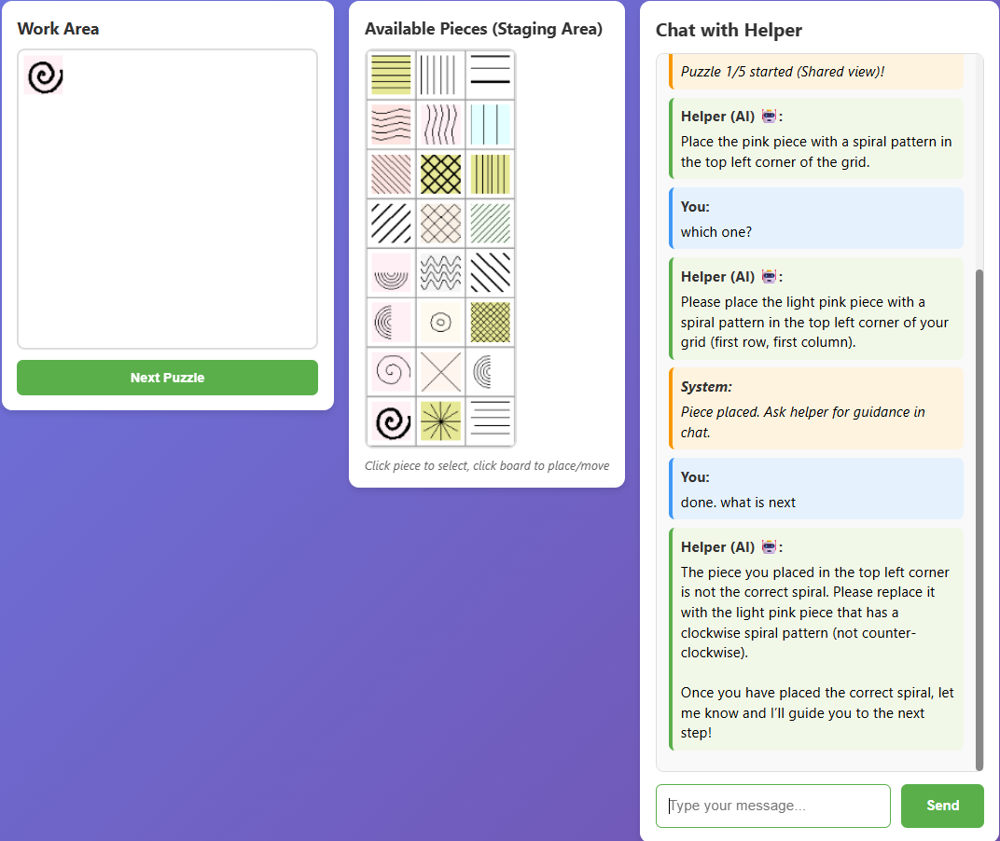
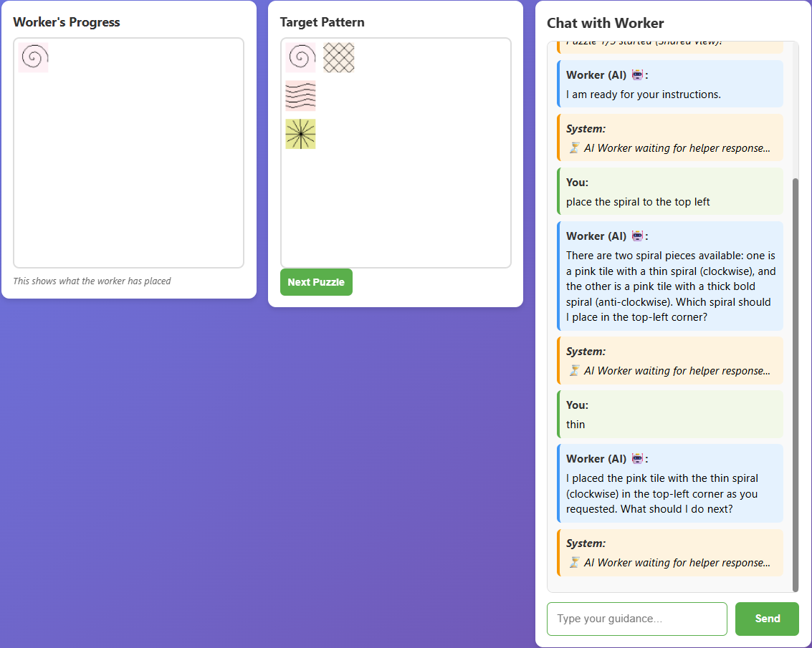

# CommonGround

**A collaborative puzzle environment for studying how people and AI build common ground.**

One partner knows the target pattern; the other must build it from instructions.
Through chat, they describe pieces, clarify ambiguous references, and repair
misunderstandings. Their dialogue and actions provide a record for studying
**common ground**: the shared understanding that enables collaboration.

Play with a human or AI partner in either role, or run headless AI-AI experiments.

[Quick start](#quick-start) |
[Screenshots](#screenshots) |
[Run modes](#run-modes) |
[AI setup](#ai-backend-configuration) |
[Study setup](#running-a-study) |
[Citation](#citation)

> **Research paper**
>
> Christian Poelitz, Finale Doshi-Velez, and Siân Lindley (2026).
> [**A Benchmark to Assess Common Ground in Human-AI Collaboration**](https://arxiv.org/abs/2602.21337).
> arXiv:2602.21337.

The paper introduces the benchmark and examines collaboration under different
levels of situation awareness. See it for the research motivation, study design,
and findings, and use the [BibTeX citation below](#citation) when referencing the
work.

## The task

- The **Worker** selects from 24 colored pattern tiles and places them on a
  **6x6 grid** to reproduce a target pattern.
- The **Helper** sees the target and guides the Worker through chat. The Worker
  cannot see the target.
- In **shared view**, the Helper can also see the Worker's board. In
  **non-shared view**, the Helper must rely on the conversation to track progress.
- Either role can be played by a human or an LLM agent.

The asymmetric information makes the task useful for studying descriptions,
clarification, coordination, and the repair of misunderstandings. The interactive
application uses Flask and Socket.IO; a separate headless runner supports
automated experiments.

## Screenshots

Both examples below use **shared view**. In non-shared view, the Helper cannot
see the Worker's progress. Select an image to open the full-size screenshot.

### Human Worker with an AI Helper

The human selects and places tiles, while the AI provides instructions and
feedback. The chat illustrates a grounding problem: identifying which spiral
piece the Helper means.

[](Screenshot_Human_Worker.png)

### Human Helper with an AI Worker

The human sees the target pattern and guides the AI through chat. Here, the AI
Worker asks which spiral tile to use before continuing.

[](Screenshot_Human_Helper.png)

## Quick start

Start with **human-human** mode to try the task without an AI account or API key.
You will need Python, pip, and a modern browser. The application and regression
tests have been tested with Python 3.12.

Run the following commands from the repository root. Keep the virtual environment
active when using the commands elsewhere in this guide.

### Windows PowerShell

```powershell
python -m venv .venv
.\.venv\Scripts\Activate.ps1
python -m pip install -r requirements.txt
python run.py human-human
```

If PowerShell activation is unavailable, use `.\.venv\Scripts\python.exe`
instead of `python` after creating the virtual environment.

### macOS / Linux

```bash
python3 -m venv .venv
source .venv/bin/activate
python -m pip install -r requirements.txt
python run.py human-human
```

Once the server starts:

1. Open the printed **Worker** and **Helper** links in separate browsers or
   browser profiles. Keep the shared room identifier in both links.
2. In the **Helper** view, click **Start Puzzle 1** to reveal the target.
3. Use the chat to guide the Worker in selecting and placing pieces.

Stop the server with **Ctrl+C** before switching run modes. To play with an AI
partner, configure a backend below, then choose a [run mode](#run-modes).

## AI backend configuration

Human-AI and AI-AI modes require a configured model backend. Create `.env` from
[`.env.example`](.env.example) **only if you do not already have one**; do not
overwrite existing credentials. Configure one of the following backends:

| Backend | Configuration |
| --- | --- |
| **Standard OpenAI** | Set `OPENAI_API_KEY` to your API key and `OPENAI_GPT4_DEPLOYMENT` to the model name. Leave `OPENAI_ENDPOINT` empty. |
| **Azure OpenAI with an API key** | Set `OPENAI_ENDPOINT`, `OPENAI_API_KEY`, `OPENAI_GPT4_DEPLOYMENT`, and `OPENAI_API_VERSION`. Leave `OPENAI_SCOPE` empty. |
| **Azure OpenAI with Entra ID** | Authenticate through Azure CLI or managed identity, then set `OPENAI_ENDPOINT`, `OPENAI_SCOPE`, `OPENAI_GPT4_DEPLOYMENT`, and `OPENAI_API_VERSION`. |

Use a **vision-capable model compatible with the Chat Completions API**: agents
receive rendered boards and tile images alongside conversation context.
`OPENAI_GPT4_DEPLOYMENT` is the model name for OpenAI and the deployment name for
Azure OpenAI, despite the variable's legacy name.

For Azure endpoints, a non-empty `OPENAI_SCOPE` selects Entra ID authentication
even if an API key is also set. AI modes send requests to the configured provider
and may incur API charges.

## Run modes

| Mode | Worker | Helper | Command |
| --- | --- | --- | --- |
| **Human-human** | Human | Human | `python run.py human-human` |
| **Human-AI: you build** | Human | AI | `python run.py human-ai` |
| **Human-AI: you guide** | AI | Human | `python run.py human-ai --role helper` |
| **AI-AI: headless** | AI | AI | `python run.py ai-ai` |

The [PowerShell launcher](run.ps1) (`.\run.ps1 <mode>`) and
[Bash launcher](run.sh) (`bash run.sh <mode>`) accept the same arguments and
prefer the project's virtual environment when available.

### Human-AI

```powershell
python run.py human-ai
python run.py human-ai --role helper      # Human Helper + AI Worker
python run.py human-ai --no-shared-view   # Initial non-shared-view setting
```

Open <http://localhost:5000>, then click **Start Puzzle 1**.
**`--role` always selects the human's role; the AI takes the other role.**
The server enforces this pairing for direct role links and socket reconnections,
so old URL parameters or browser selections cannot change the chosen mode.

Add `--port 5001` to use a different port. The `--no-shared-view` flag sets the
initial view, but each puzzle's `group` determines visibility when the trial
starts; see [puzzle configuration](#puzzles-and-experimental-conditions).

After changing launch modes, restart the server and refresh the browser.

### Human-human

The launcher prints a pair of links:

```text
Worker: http://localhost:5000/worker?session=<room>&auto_worker=human&auto_helper=human
Helper: http://localhost:5000/helper?session=<room>&auto_worker=human&auto_helper=human
```

Both players must use the **same** `session=<room>` value to join the same game.
The `localhost` links work on the machine running the server; for another machine,
use the server's reachable hostname or IP address instead.

### AI-AI (headless)

```powershell
python run.py ai-ai --limit 1 --max-turns 5  # Small initial run
python run.py ai-ai                         # All configured puzzles
python run.py ai-ai --max-turns 15          # Worker-turn limit per puzzle
```

The runner prints the dialogue, actions, and outcome for each puzzle and writes
logs. A puzzle is solved when the Worker's board **exactly matches** the target;
otherwise the runner stops that puzzle at the turn limit. The default is
**20 Worker turns per puzzle**. Use `--limit` and `--max-turns` to bound a run
before starting larger experiments.

## Puzzles and experimental conditions

Puzzles are defined in [`utils/puzzles.json`](utils/puzzles.json) and run in file
order. Each entry supports:

| Field | Meaning |
| --- | --- |
| `puzzle_number` | Identifier displayed during the trial. |
| `tiles` / `positions` | Corresponding tile IDs (0-23) and `[x, y]` target cells. Coordinates start at `[0, 0]` in the top-left; each axis ranges from 0 to 5. |
| `group` | `"Shared view"` or `"Non-shared view"`; determines whether the Helper sees the Worker's board. |
| `condition` | `"uncertainty"` selects the AI Worker's ambiguity-aware prompts; other values use its standard prompts. |
| `require_complete` | If `true`, blocks "Next puzzle" until every target cell contains the correct tile, or the timeout expires. Extra tiles in non-target cells are allowed by this gate. |
| `require_complete_timeout` | Seconds before the completion gate unlocks automatically; defaults to 300. |

**Treat the puzzle file as the source of truth for the experiment.** Review its
conditions before running a study rather than assuming a fixed shared-view or
uncertainty setting. The launcher runs puzzles in file order; it does not
randomize or balance conditions.

Tile rendering is defined in [`puzzle_constants.py`](puzzle_constants.py), and
agent instructions are in [`ai/prompts.py`](ai/prompts.py).

## Running a study

The web modes accept `--study` to require consent and login:

```powershell
python run.py human-ai --role helper --study
```

Credentials are loaded from `USER_CREDENTIALS_FILE`, defaulting to
`utils/user_credentials.json`. [`generate_users.py`](generate_users.py) generates
a new credentials file, but its default output is `generated_users.json`; set
`USER_CREDENTIALS_FILE` to that path or explicitly choose an output location.
Do not overwrite credentials for an active study.

Set `FORMS_QUESTIONNAIRE_URL` to direct participants to a post-task questionnaire.
Authenticated admins can download collected logs at `/admin/download_logs`.

## Logging and analysis

Local runs write to `logs/` by default; override the location with `LOG_DIR`.
On Linux Azure App Service, the default is `/home/logs`.

- `sessions/*.jsonl`: per-session event streams, including chat and game actions.
- `summaries/`: session summaries.
- `trial_summary.csv` and `*_detailed.json`: AI trial summaries and detailed records.

AI calls also write the latest model-request payload to `last_message_sent.json`
in the working directory, which must be writable. This debug file can contain
conversation context and board images.

Analysis notebooks are in [`log_analysis/`](log_analysis/).
**Keep credentials, model-request payloads, conversation logs, and participant
data out of version control.** AI modes send conversation and image data to the
configured model provider; account for this when planning a study.

Active game state is held in server memory, not restored from the logs. Restarting
the server loses active boards; multi-process or multi-instance deployment would
require shared session state.

## Companion rating application

[`uncertainty_grading/`](uncertainty_grading/) is a separate Flask application for
collecting human ratings of AI Worker behavior. It presents frozen dialogue and
board snapshots across conditions A-E, with ratings before or after a Worker
response, rather than running live puzzle agents.

Its rendered board images are kept locally in
`uncertainty_grading/stimuli/boards/` and are not tracked by Git. Fresh checkouts
need the matching image assets before running the rating application. The main
puzzle game generates its own images and does not depend on that directory.

See its [README](uncertainty_grading/README.md) for its own setup, participant
assignments, study conditions, and data-handling guidance.

## Troubleshooting

| Symptom | What to check |
| --- | --- |
| An AI mode behaves like human-human mode | Restart the updated server with the intended `human-ai` command, then open the home page to reach the correct role. `--role` describes the human, not the AI. |
| The AI replies with `ERROR: Event loop is closed` | Update the code and stop the server completely before restarting it. Web AI requests now share a persistent event loop; refreshing a browser alone does not replace an older server's cached client. |
| The Helper cannot see the Worker's board | Check the puzzle's `group`. Hiding the progress panel is intentional in non-shared view. |
| **Next Puzzle** is disabled | Check `require_complete`: every target cell must match, or the configured completion-gate timeout must expire. |
| Python cannot import an installed dependency | Activate the project's virtual environment and install `requirements.txt` using that interpreter. |

## Tests

From the repository root, with the project dependencies installed:

```powershell
python -m unittest discover -s tests -v
```

The [regression suite](tests/) covers role selection, study-mode gates, repeated
AI replies, session isolation, and async execution. Model responses are mocked or
served by a local HTTP stub; the tests do not call external model endpoints.

## Project layout

| Path | Responsibility |
| --- | --- |
| [`run.py`](run.py) | Unified launcher for all three modes. |
| [`ai_vs_ai.py`](ai_vs_ai.py) | Headless AI-AI experiment runner. |
| [`web_app.py`](web_app.py), [`routes.py`](routes.py) | Flask application, pages, login, and consent. |
| [`socket_handlers.py`](socket_handlers.py) | Real-time game events and background AI turns. |
| [`game_session.py`](game_session.py) | Game state, board actions, trial progression, and AI integration. |
| [`ai/`](ai/) | Agents, model client, shared async execution, prompts, action parsing, image serialization, and trial logging. |
| [`utils/`](utils/) | Settings, puzzle definitions, and authentication helpers. |
| [`templates/`](templates/), [`static/`](static/) | Browser interfaces and styling. |
| [`web_logger.py`](web_logger.py) | Session event logging. |
| [`tests/`](tests/) | Offline regression tests for web modes and AI request execution. |
| [`uncertainty_grading/`](uncertainty_grading/) | Companion human-rating application and frozen study stimuli. |

Launch and deployment helpers include [`deploy_azure.ps1`](deploy_azure.ps1),
[`startup.sh`](startup.sh), [`startup_minimal.sh`](startup_minimal.sh), and
[`puzzle-webapp.service`](puzzle-webapp.service).

## Citation

If you use the benchmark in your research, please cite:

```bibtex
@misc{poelitz2026benchmarkassesscommonground,
  title         = {A Benchmark to Assess Common Ground in Human-AI Collaboration},
  author        = {Christian Poelitz and Finale Doshi-Velez and Si{\^a}n Lindley},
  year          = {2026},
  eprint        = {2602.21337},
  archivePrefix = {arXiv},
  primaryClass  = {cs.HC},
  url           = {https://arxiv.org/abs/2602.21337}
}
```

## License

CommonGround is available under the [MIT License](LICENSE).
